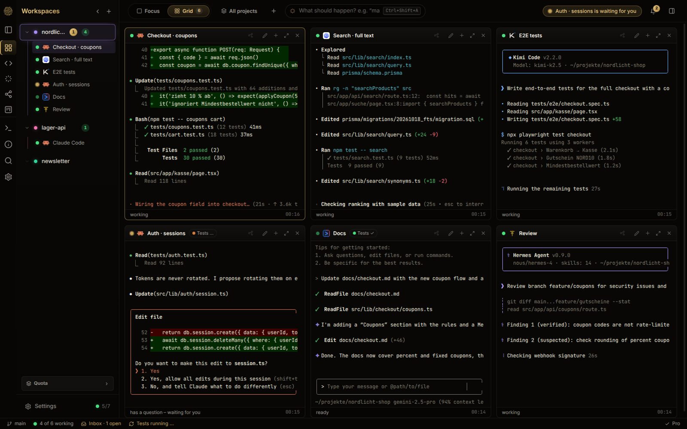
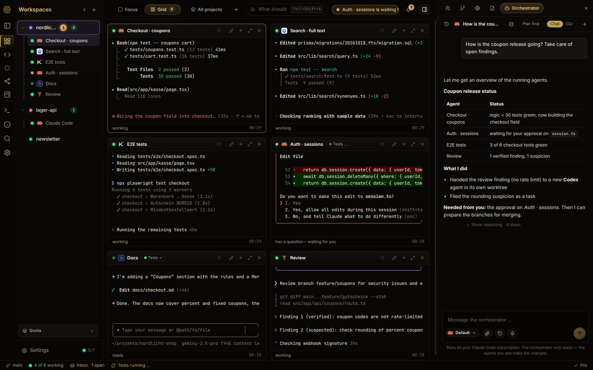
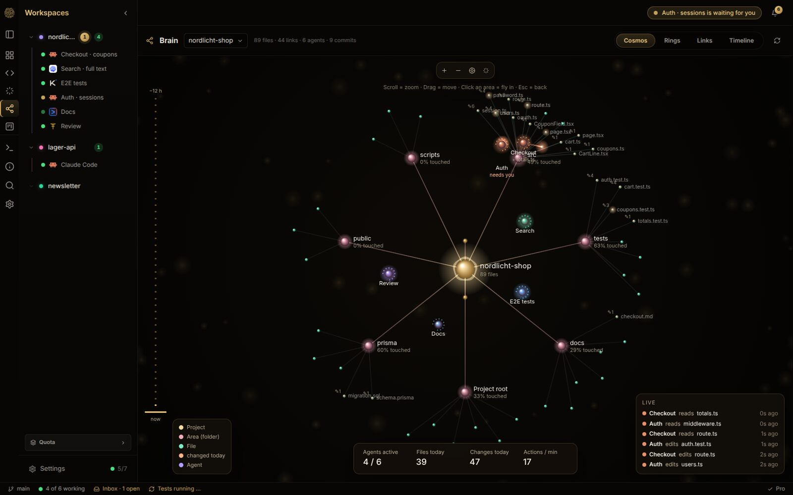
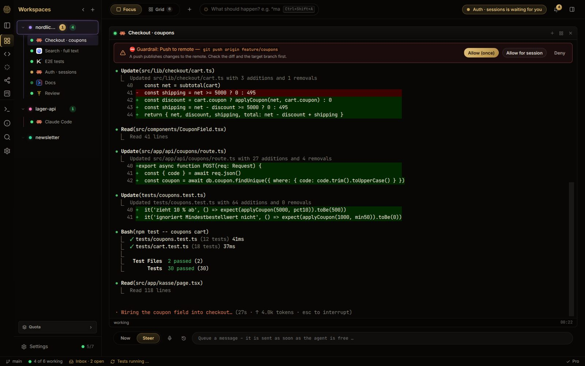
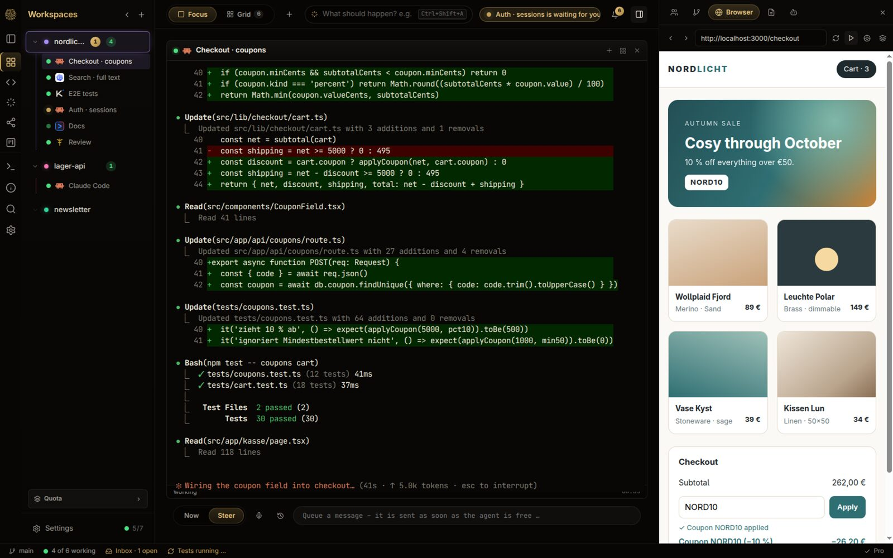
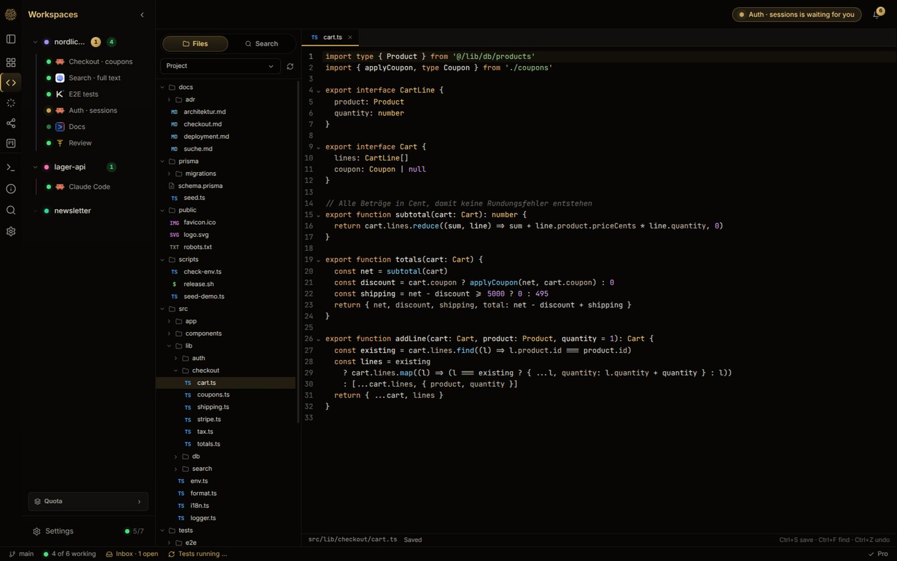

# OpenCognit Desktop

**Every coding agent. One window.**

Run Claude Code, Codex, Gemini CLI, Kimi and Hermes side by side — locally, with the subscriptions you already have.

⭐ **Like it? Star this repo** — it helps others find OpenCognit.

---

## See it in action

  
   
  ▶ <a href="https://github.com/OpenCognitOS/opencognit-releases/raw/main/assets/teaser.mp4">Watch the 30-second teaser</a>

<table>
  <tr>
    <td width="50%"> <b>Grid</b> — every agent in a real terminal, side by side</td>
    <td width="50%"> <b>Orchestrator</b> — describe a goal, it hands out the work</td>
  </tr>
  <tr>
    <td> <b>Kosmos</b> — watch live who reads or edits which file</td>
    <td> <b>Guardrails</b> — risky commands wait for your OK</td>
  </tr>
  <tr>
    <td> <b>Live preview</b> — the result right next to your agents</td>
    <td> <b>Editor & Git</b> — review and commit without a second app</td>
  </tr>
</table>

## About

Installers and release notes for **OpenCognit Desktop**, the command center for AI coding agents:
run **Claude Code, Codex, Gemini CLI, Kimi and Hermes side by side** in one window — on your
machine, with the subscriptions you already have.

> [!NOTE]
> OpenCognit Desktop is in **beta**. Expect rough edges — feedback is very welcome on
> [Discord](https://discord.gg/xASbhwdaS).

## Download

Grab the latest version from **[Releases](../../releases/latest)**:

| System | File |
|---|---|
| Linux (any distro) | `OpenCognit-<version>-x86_64.AppImage` — make it executable, then run it |
| Debian / Ubuntu | `OpenCognit-<version>-amd64.deb` — `sudo apt install ./OpenCognit-<version>-amd64.deb` |
| Windows | `OpenCognit-Setup-<version>.exe` *(coming soon)* |

The app checks this page for new versions and offers updates itself — nothing else is sent.

## What you need

At least one coding CLI you already use, e.g. Claude Code, Codex, Gemini CLI, Kimi Code or
Hermes. OpenCognit runs them with your existing logins and subscriptions.

## Feedback & bugs

Join the [Discord](https://discord.gg/xASbhwdaS) and post in `#bug-reports`: what you did, what you
expected, a screenshot, your OS, CLI and OpenCognit version.

---

OpenCognit Desktop is proprietary software. This repository only contains release files, not the
source code.
