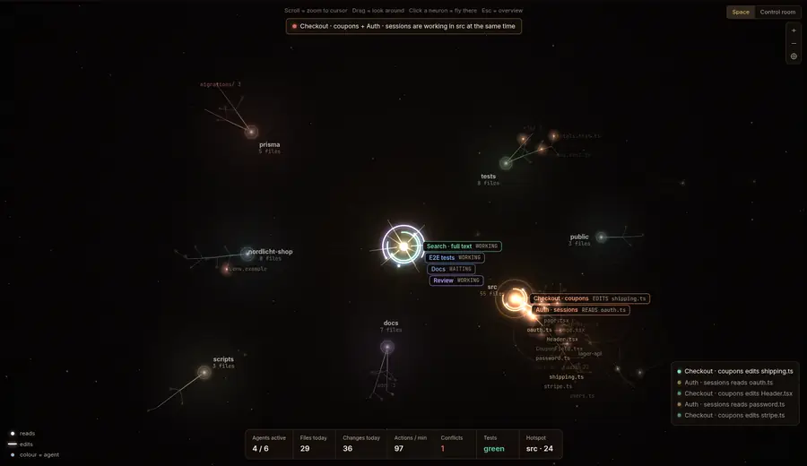
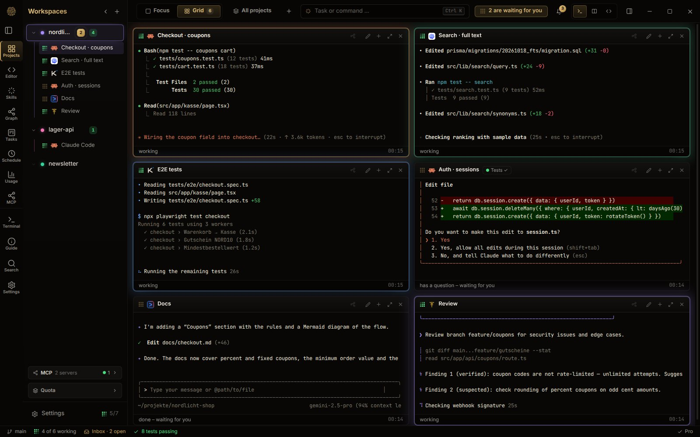
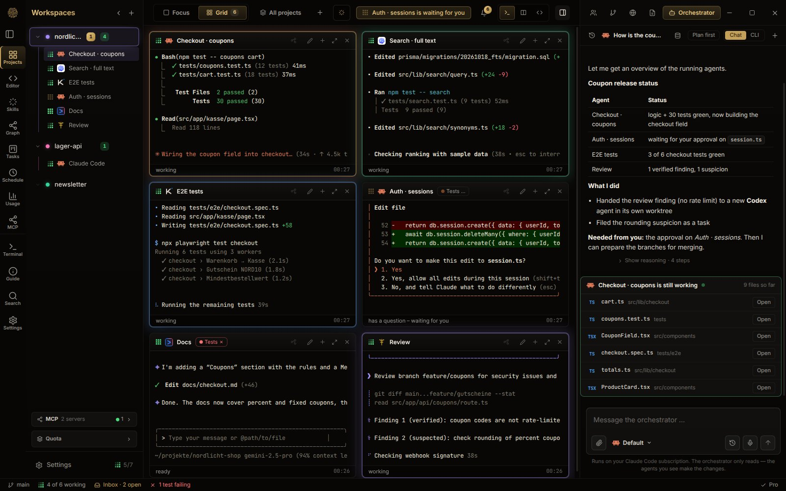
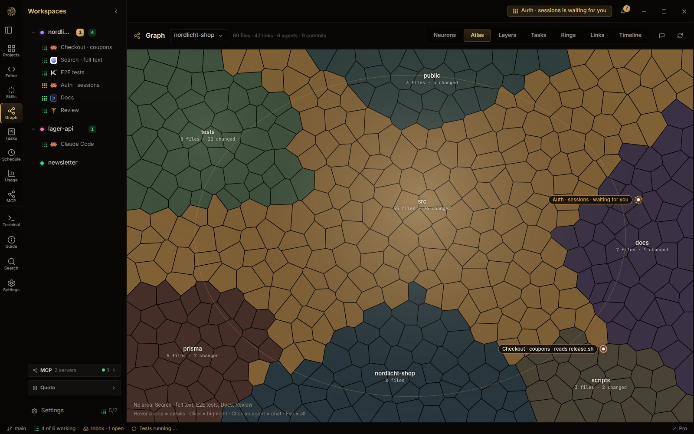
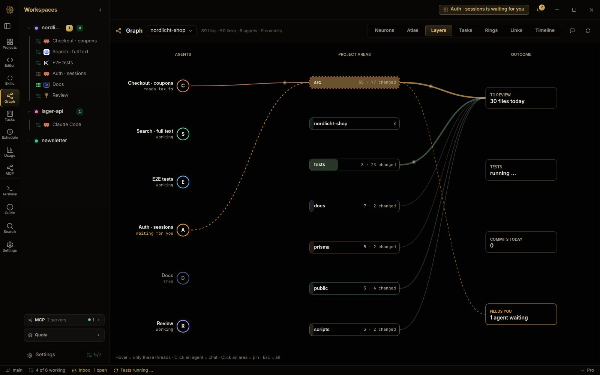
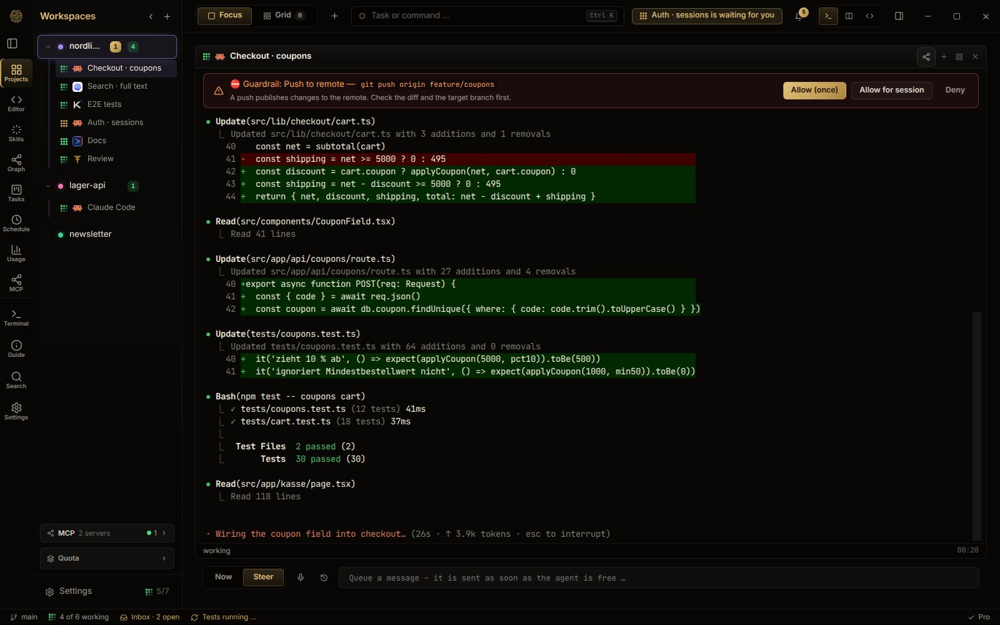
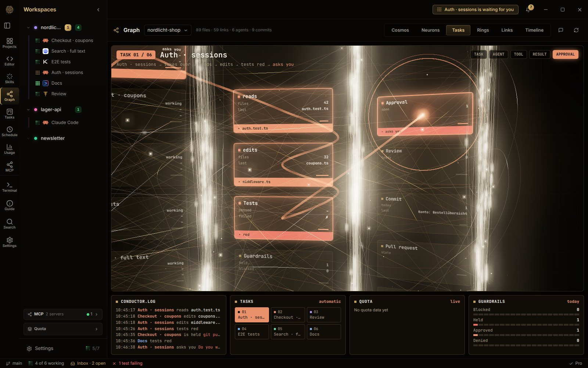
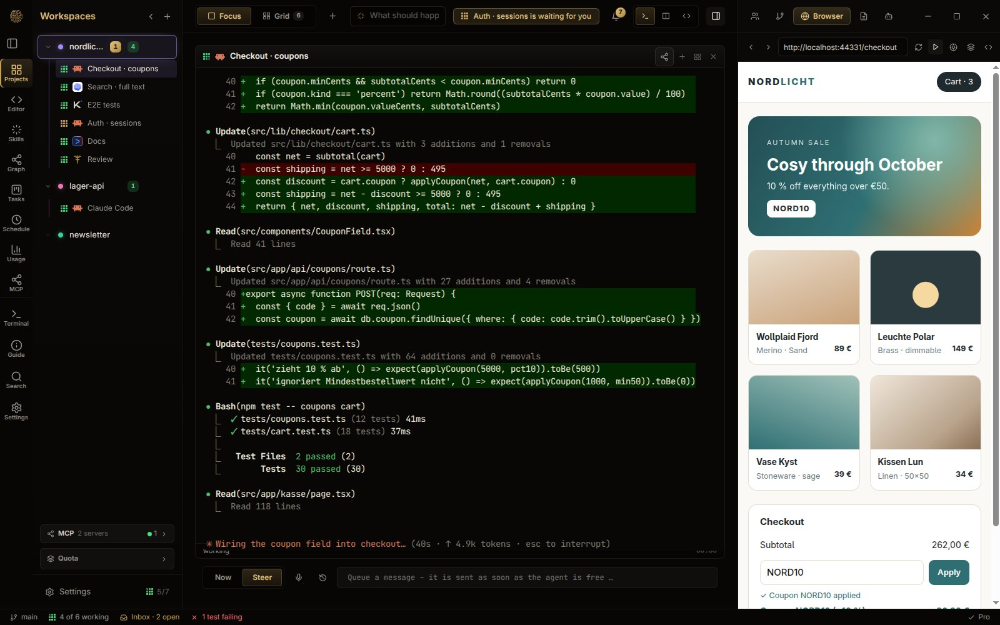
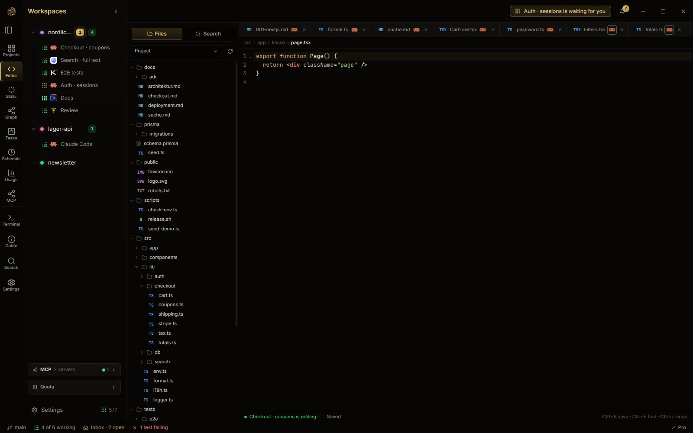

# OpenCognit Desktop

**You think. They build.**

Run Claude Code, Codex, Gemini CLI, Kimi and Hermes side by side — locally, with the subscriptions you already have.

**[⬇ Download for Linux](https://github.com/OpenCognitOS/opencognit-releases/releases/latest/download/OpenCognit-linux-x86_64.AppImage)** · **[⬇ Download for Windows](https://github.com/OpenCognitOS/opencognit-releases/releases/latest/download/OpenCognit-windows-setup.exe)** · [.deb](https://github.com/OpenCognitOS/opencognit-releases/releases/latest/download/OpenCognit-linux-amd64.deb) · [All releases](https://github.com/OpenCognitOS/opencognit-releases/releases)

⭐ **Like it? Star this repo** — it helps others find OpenCognit.

---

  
   
  <b>Neurons</b> — every agent is a ring at the folder it works in; pulses run along the branches in its colour

<table>
  <tr>
    <td width="50%"> <b>Grid</b> — every agent in a real terminal, side by side</td>
    <td width="50%"> <b>Orchestrator</b> — describe a goal, it hands out the work</td>
  </tr>
  <tr>
    <td> <b>Atlas</b> — your project as a brain map: which agent works in which area</td>
    <td> <b>Layers</b> — agents, project areas and outcome at a glance</td>
  </tr>
  <tr>
    <td> <b>Guardrails</b> — risky commands wait for your OK</td>
    <td> <b>Task wall</b> — every task traced from start to commit</td>
  </tr>
  <tr>
    <td> <b>Live preview</b> — the result right next to your agents</td>
    <td> <b>Editor & Git</b> — review and commit without a second app</td>
  </tr>
</table>

## About

Installers and release notes for **OpenCognit Desktop**, the command center for AI coding agents:
run **Claude Code, Codex, Gemini CLI, Kimi and Hermes side by side** in one window — on your
machine, with the subscriptions you already have.

## Download

Grab the latest version from **[Releases](../../releases/latest)**:

| System | File |
|---|---|
| Linux (any distro) | `OpenCognit-<version>-x86_64.AppImage` — make it executable, then run it |
| Debian / Ubuntu | `OpenCognit-<version>-amd64.deb` — `sudo apt install ./OpenCognit-<version>-amd64.deb` |
| Windows 10/11 | `OpenCognit-Setup-<version>.exe` — not signed yet: on a SmartScreen warning click „More info“ → „Run anyway“ |

The app checks this page for new versions and offers updates itself — nothing else is sent.

## Requirements

- **Linux or Windows 10/11, 64-bit (x86_64)** — ARM not yet supported
- **At least one coding CLI**, installed and logged in: Claude Code, Codex, Gemini CLI, Kimi Code or
  Hermes (they bring their own needs, usually Node.js; Hermes uses Python)
- **Git** — recommended for snapshots, worktrees, variants and the review card
  (the `.deb` installs it for you)
- Optional: GitHub CLI (`gh`) for pull requests

> [!TIP]
> **AppImage won't start?** Newer Ubuntu versions don't ship FUSE 2 anymore:
> `sudo apt install libfuse2t64` (Ubuntu 24.04) or `sudo apt install libfuse2` (22.04).
> The `.deb` doesn't need it.

## Feedback & bugs

- **Bug report:** [open an issue](https://github.com/Panto92/Opencognit/issues/new/choose) with what you
  did, what you expected, your OS, CLI and OpenCognit version.
- **Questions and ideas:** [Discussions](https://github.com/Panto92/Opencognit/discussions) or the
  [Discord](https://discord.gg/xASbhwdaS).

---

OpenCognit Desktop is proprietary software. This repository only contains release files, not the
source code.
